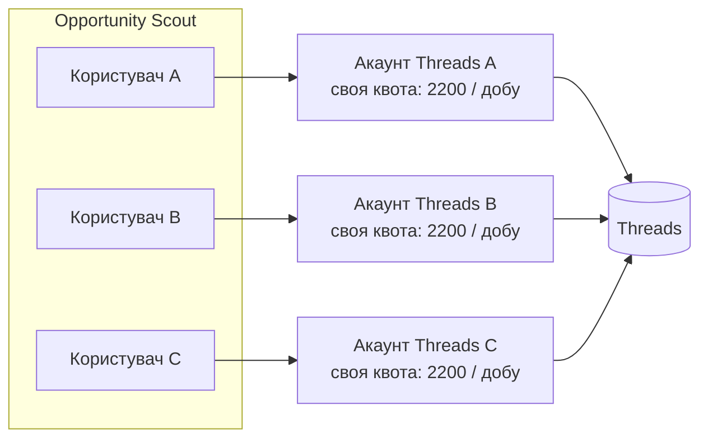
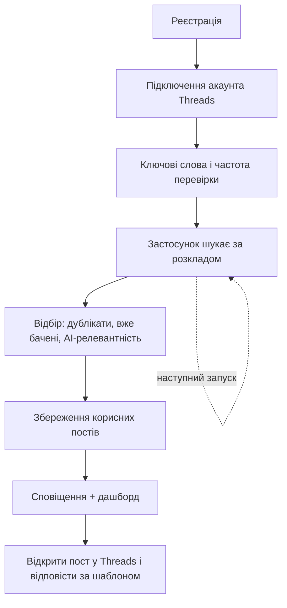
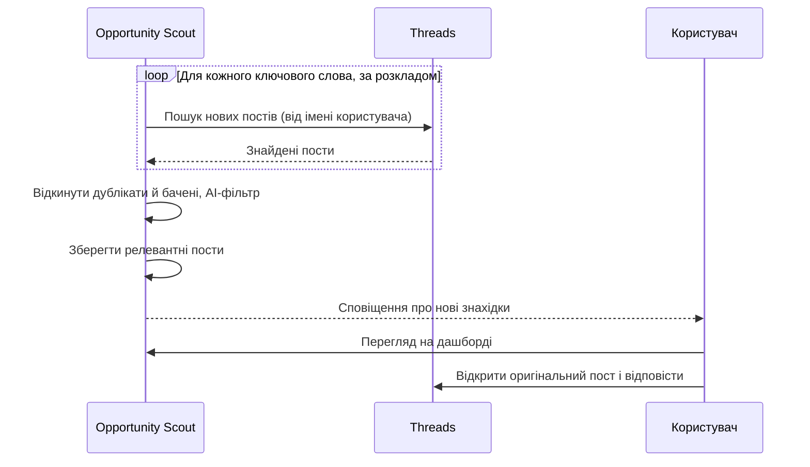
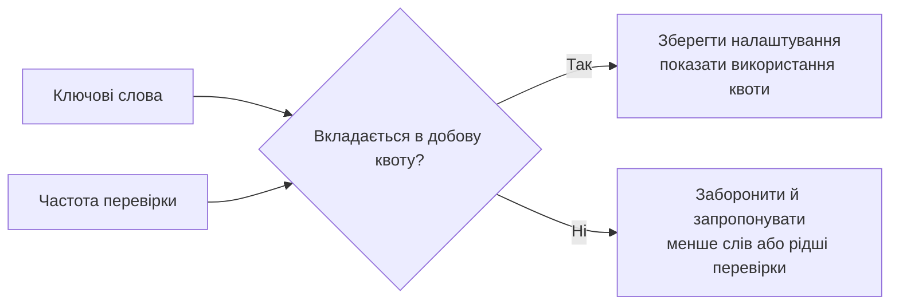
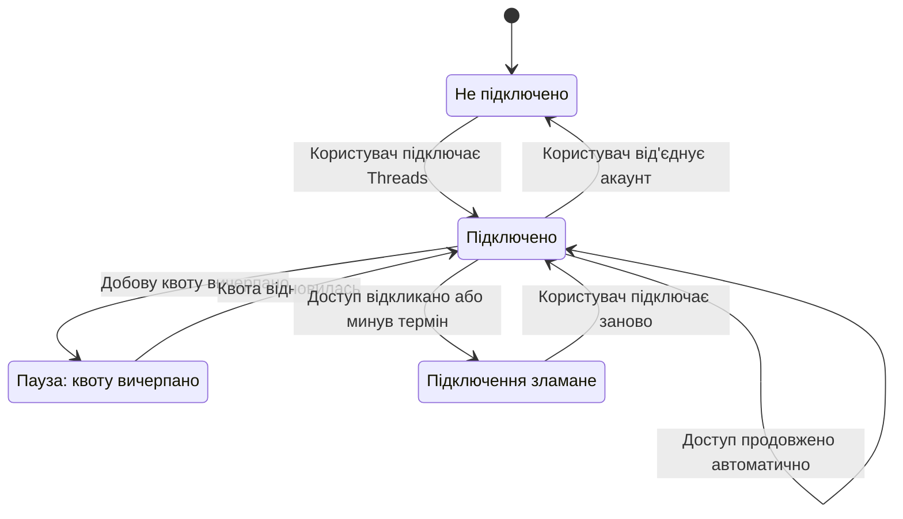
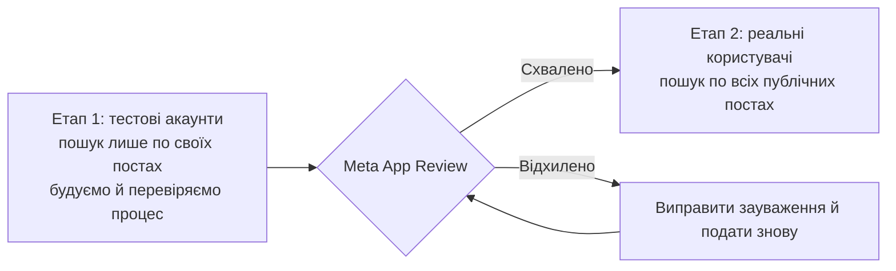

# Концепція: як Opportunity Scout працює з Threads

- Створено: 2026-10-22 20:09
- Статус: draft
- Запит: Описати загальну концепцію інтеграції з Threads і пошуку за ключовими словами без технічних деталей: чи кожен користувач підключає свій акаунт, як працюють ліміти, шлях користувача.
- Пов'язане: [План підготовки](2026-10-22-1956--threads-api-preparation_uk.md)

## 1. Кожен користувач підключає свій власний акаунт Threads

- **Ліміти.** Meta рахує ліміт пошуку (2200 запитів на добу) на кожен акаунт Threads окремо. Якщо всі шукатимуть через один спільний акаунт, ліміт закінчиться швидко. Коли кожен шукає зі свого акаунта, у кожного свій ліміт.
- **Правила Meta.** Дозвіл на пошук видають застосункам, які діють від імені конкретного користувача й допомагають йому вести свою присутність у соцмережах. Один «службовий» акаунт для всіх суперечить цій моделі й ризикує блокуванням застосунку.
- **Надійність.** Якщо Meta обмежить один акаунт, перестане працювати тільки в цього користувача, а не в усіх.

Ліміт рахується на акаунт, а не на застосунок. Якщо користувач паралельно користується іншими сервісами пошуку по Threads, вони витрачають ту саму квоту.

## 2. Шлях користувача

1. **Реєстрація** в Opportunity Scout.
2. **Підключення Threads.** Кнопка «Підключити Threads» → вхід у Threads → дозвіл на пошук → повернення в застосунок. Від'єднати акаунт можна будь-коли.
3. **Налаштування пошуку.** Ключові слова (наприклад, «шукаю дизайнера», «потрібен розробник») і частота перевірки.
4. **Автоматичний пошук.** Застосунок сам за розкладом шукає нові пости за кожним ключовим словом від імені користувача. Сам користувач нічого не натискає.
5. **Відбір.** Застосунок відкидає дублікати й уже бачені пости, фільтр (зокрема AI) прибирає нерелевантне. Зберігаються тільки потенційно корисні пости.
6. **Результат.** Користувач отримує сповіщення про нові знахідки й бачить їх на дашборді зі статистикою. Звідти відкриває оригінальний пост у Threads і відповідає сам, використовуючи збережений шаблон відповіді.

## 3. Один цикл пошуку

## 4. Ліміти в інтерфейсі

Кількість ключових слів і частота перевірки разом витрачають добову квоту. Тому застосунок має:

- показувати, яку частину квоти займають поточні налаштування;
- не дозволяти налаштування, які її перевищать (наприклад, 50 слів щохвилини);
- якщо квота все ж закінчилася, призупиняти пошук до відновлення й пояснювати користувачу чому.

## 5. Стан підключення

- Доступ до Threads діє обмежений час, і застосунок продовжує його автоматично.
- Якщо підключення зламалося (користувач відкликав доступ у Threads або минув термін), пошук зупиняється, а користувач отримує повідомлення: «Підключіть Threads заново».

Пошук працює тільки в стані «Підключено». У станах «Пауза» та «Підключення зламане» користувач бачить, чому пошук зупинився.

## 6. Етапи запуску

- **До схвалення Meta** пошук бачить тільки власні пости підключеного акаунта. На цьому етапі працюємо лише з тестовими акаунтами: будуємо й перевіряємо весь процес.
- **Після схвалення** пошук охоплює всі публічні пости, і продуктом можуть користуватися реальні користувачі.

