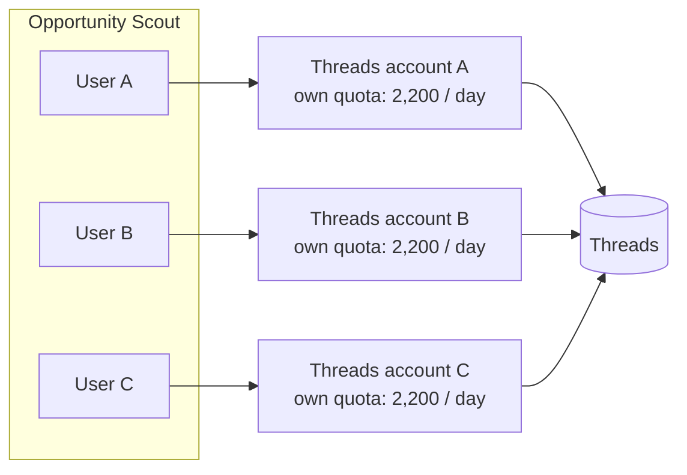
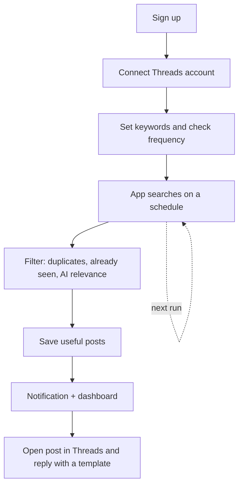
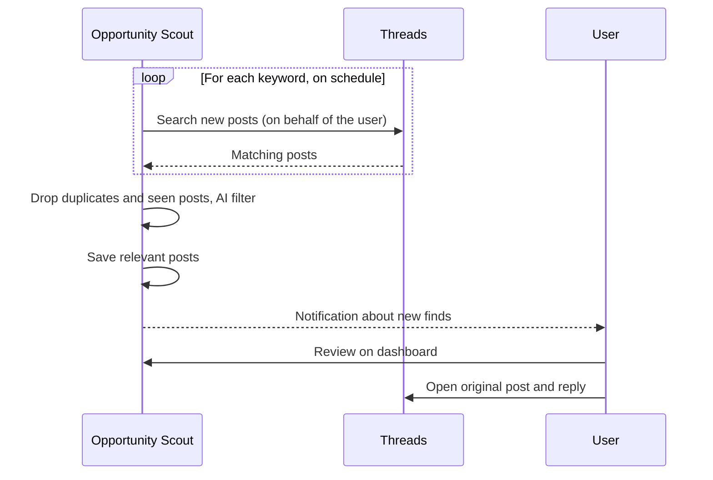
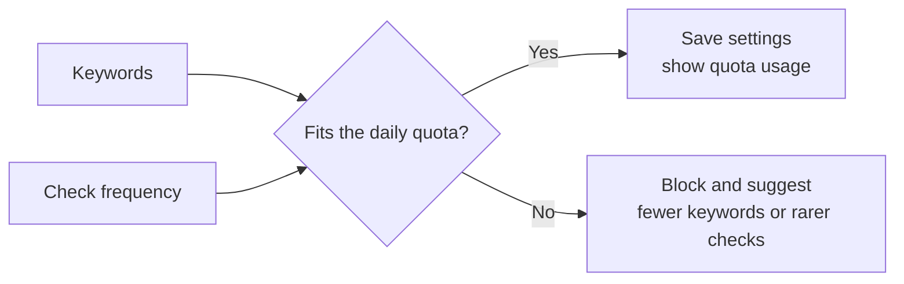
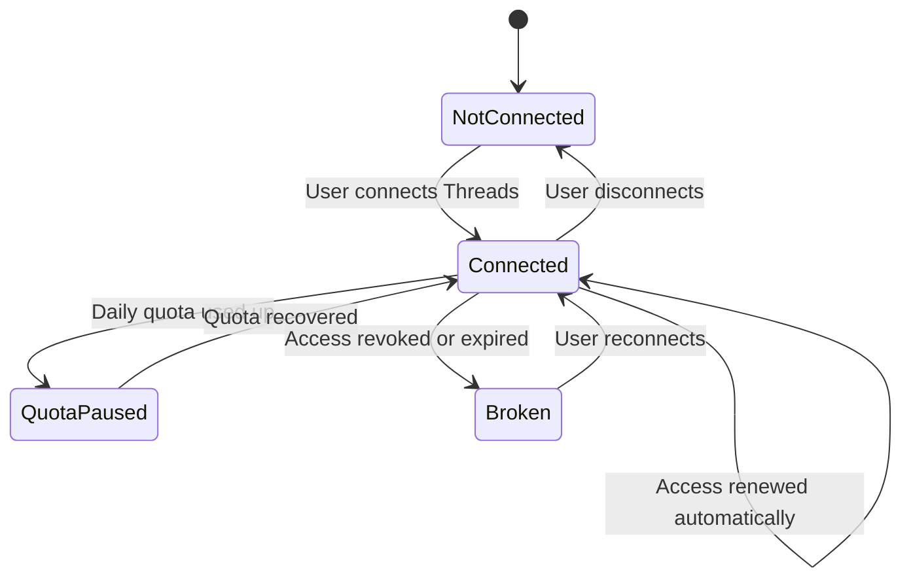
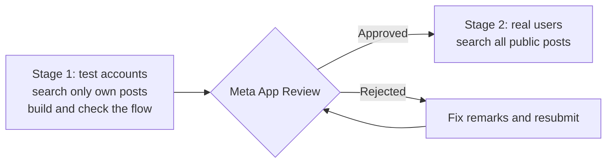

# Concept: how Opportunity Scout works with Threads

- Created: 2026-10-22 20:09
- Status: draft
- Request: Describe the overall concept of the Threads integration and keyword search without technical details: whether each user connects their own account, how limits work, the user journey.
- Related: [Preparation plan](2026-10-22-1956-threads-api-preparation.md)

## 1. Each user connects their own Threads account

- **Limits.** Meta counts the search limit (2,200 queries per 24 hours) per Threads account. One shared account for everyone would run out fast. With their own account, each user gets their own quota.
- **Meta rules.** The search permission is granted to apps that act on behalf of a specific user and help them manage their social media presence. One "service" account for all users goes against this model and risks the app being blocked.
- **Reliability.** If Meta restricts one account, only that user is affected, not everyone.

The limit is per account, not per app. If a user also uses other Threads search tools, those spend the same quota.

## 2. User journey

1. **Sign up** in Opportunity Scout.
2. **Connect Threads.** "Connect Threads" button → log in to Threads → allow search → back to the app. The account can be disconnected at any time.
3. **Set up search.** Keywords (e.g. "looking for a designer", "need a developer") and how often to check.
4. **Automatic search.** The app searches for new posts for each keyword on a schedule, on behalf of the user. The user doesn't have to do anything.
5. **Filtering.** The app drops duplicates and posts it has already seen, and the filter (including AI) removes irrelevant ones. Only potentially useful posts are saved.
6. **Result.** The user gets a notification about new finds and sees them on the dashboard with statistics. From there they open the original post in Threads and reply themselves, using the saved reply template.

## 3. One search cycle

## 4. Limits in the UI

The number of keywords and the check frequency together spend the daily quota. So the app should:

- show how much of the quota the current settings use;
- not allow settings that would exceed it (e.g. 50 keywords every minute);
- if the quota still runs out, pause search until it recovers and tell the user why.

## 5. Connection state

- Access to Threads is valid for a limited time, and the app renews it automatically.
- If the connection breaks (the user revoked access in Threads, or it expired), search stops and the user is told to reconnect Threads.

Search runs only in the `Connected` state. In `QuotaPaused` and `Broken` the user sees why it stopped.

## 6. Launch stages

- **Before Meta approval**, search sees only the connected account's own posts. At this stage we work only with test accounts and build and check the whole flow.
- **After approval**, search covers all public posts, and real users can use the product.

